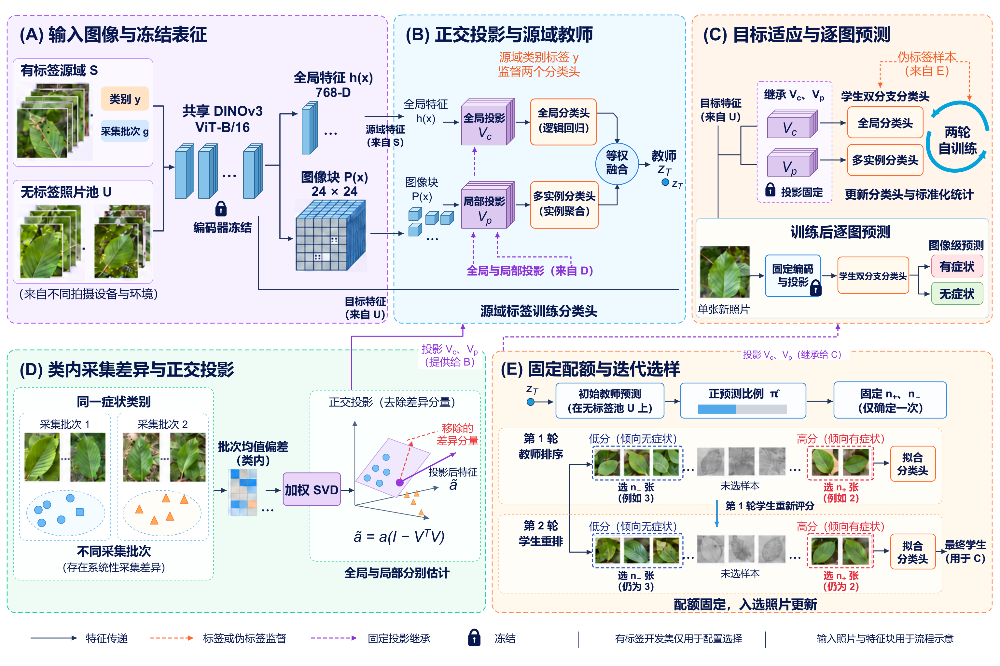

# STAND: Cross-domain Beech Leaf Disease Recognition

**融合正交投影与伪标签自训练的山毛榉叶病跨域识别**

STAND (Session-aware Teacher And uNlabeled Distillation) uses a frozen DINOv3 encoder, class-conditioned capture-batch projections, global/local teacher heads, and two rounds of pseudo-label self-training on an independent unlabeled photo pool.

[中文说明与实验流程](#运行流程) · [论文 PDF](paper/STAND_paper_zh.pdf) · [评估协议](docs/PROTOCOL.md) · [数据来源](docs/DATA.md)



The latest method figure is also available as an [editable SVG](paper/research_figures/STAND_framework_zh.svg). Its photographic thumbnails and feature-map illustrations explain the workflow; they are not experimental outputs.

## Repository contents

| Directory | Contents |
|---|---|
| `code/` | Feature extraction, teacher/student fitting, CNN baselines, prediction, and evaluation |
| `configs/stand.json` | The configuration used for the reported STAND main result |
| `models/` | Exported student heads, projections, and normalization statistics; no encoder weights |
| `data/` | Fixed image manifests and capture/photographer-separated splits |
| `reference_results/` | Recorded per-image predictions and configuration diagnostics |
| `paper/` | Current Chinese manuscript, bibliography, all included tables and figures |
| `tests/` | CPU checks for manifest separation, reported metrics, and classifier inference |

## Main external results

All entries are measured on the same **1,856-image external weak-label test set**, from **1,093 photographers**. CNN values are means of three separately trained seeds. Other rows use one model. Pretraining, source fitting, and adaptation budgets differ across methods; see the manuscript for the full comparison protocol.

| Method | Year | Accuracy (%) | Precision (%) | Recall (%) | F1 (%) | AUC (%) |
|---|---:|---:|---:|---:|---:|---:|
| Inception-v3 | 2016 | 71.17 | 87.74 | 57.34 | 67.00 | 85.24 |
| MobileNetV3-Large | 2019 | 69.31 | 89.80 | 51.13 | 63.73 | 84.46 |
| ResNet-50 | 2016 | 71.26 | 90.82 | 53.06 | 66.82 | 85.10 |
| DINOv2-B/14, source linear probe | 2024 | 77.59 | **99.18** | 59.67 | 74.51 | 95.71 |
| SigLIP 2-B/16, source linear probe | 2025 | 71.34 | 89.59 | 54.07 | 67.44 | 85.17 |
| EfficientNetV2-S, released BLD checkpoint | 2026 | 81.30 | 81.00 | 86.16 | 83.50 | 89.64 |
| **STAND** | 2026 | **91.38** | 93.87 | **90.19** | **91.99** | **97.25** |

Architecture references and the checkpoint's BLD application reference are in [Table 2 of the manuscript](paper/STAND_paper_zh.pdf). The 2025 SigLIP 2 entry uses the paper's preprint year.

## Quick verification without images or GPU

Use Python 3.11 or later. The release checks were run with Python 3.13, NumPy 2.4.1, pandas 2.3.3, and scikit-learn 1.7.2.

```bash
git clone https://github.com/liProj/STAND-BLD.git
cd STAND-BLD
python -m pip install -r requirements-eval.txt
python code/validate_data.py
python code/evaluate_reference.py --verify
python -m unittest discover -s tests -v
```

The evaluation command recomputes the table from individual predictions, averages the three CNN seed metrics, checks image/label alignment, and compares the rounded values with the manuscript.

## 运行流程

### 1. 安装训练依赖

先按本机 CUDA 环境安装匹配的 PyTorch 和 torchvision，再安装其余依赖。特征提取和原始训练实现使用 CUDA GPU。`requirements.txt` 列出所需软件包，不代表原始 GPU 实验环境的完整版本锁定。

```bash
python -m pip install -r requirements.txt
```

默认以仓库根目录作为数据和结果目录。也可通过环境变量 `STAND_ROOT` 指向另一个具有相同目录结构的位置。模型使用 `timm` 的 `vit_base_patch16_dinov3.lvd1689m`。请先取得对应模型的访问权限及使用许可；离线运行时需预先缓存权重。

### 2. 准备图像

仓库包含固定划分清单，不包含原始照片、基础模型权重或大型特征缓存。[数据说明](docs/DATA.md)给出源数据下载链接、目录结构和照片许可说明。

源域压缩包放到 `data/bld_zip/BLD_dataset.zip` 后运行预处理。公众照片按已有清单下载，避免重新查询产生不同划分。

```bash
python code/prep.py
python code/download_inat.py --set all
python code/validate_data.py --check-images
```

应得到 1,934 张源域照片、2,976 张无标签适应照片、527 张开发照片和 1,856 张外部测试照片。适应池、开发集和测试集按拍摄者隔离。

### 3. 提取冻结表征

```bash
python code/feats.py bld vit_base_patch16_dinov3.lvd1689m 384 patch
python code/feats.py inat vit_base_patch16_dinov3.lvd1689m 384 patch
python code/feats.py pool vit_base_patch16_dinov3.lvd1689m 384 patch
```

每张图像包含一个 768 维全局向量和 `24 × 24` 个图像块向量。图像块缓存会占用较多磁盘空间，训练过程将相关缓存载入内存及显存。原实现保留原来的加载方式。

### 4. 训练 STAND

```bash
python code/train.py --config configs/stand.json --dry-run
python code/train.py --config configs/stand.json
```

主配置使用 `k=8`、全局分类头 `C=0.1`、伪标签总比例参数 `rho=0.6` 和两轮学生训练。初始教师固定两类选样数量，每轮重新排序。编码器与源域投影保持固定。

结果写入 `results/preds/distill_stand.csv`，过程记录写入 `results/distill/stand.json`，分类头保存到 `results/distill/stand_heads.pt`。已存在的同名预测文件默认跳过。更改源数据、特征或投影参数时，请使用独立结果目录，避免复用旧教师分数缓存。

### 5. 使用已提供的分类头预测

`models/stand_heads.npz` 从主实验的学生模型导出，加载时不需要 pickle。可直接输入新照片，编码器权重由 `timm` 获取。

```bash
python code/predict.py --images path/to/leaf.jpg --device cuda
```

也可对已提取的冻结特征预测。

```bash
python code/predict.py --features results/feats/inat__vit_base_patch16_dinov3.lvd1689m__384.npz
```

输出包含图像文件名、分类 logit 和预测类别。分类阈值为 `logit > 0`。logit 是分类分数，不是准确率。CPU 模式可以执行逐图预测，但与原 GPU 混合精度特征提取可能存在数值差异。

### 6. 对照与消融

源域全局分类、投影及局部融合对照使用 `code/run_ours.py`。例如训练全局—局部教师并运行采集批次留出和外部评估：

```bash
python code/run_ours.py L3 k=8 mil=1 protocols=session,inat
```

各变体可直接使用原始参数接口。

```bash
python code/distill.py stand_r1 conf=adapt0.6 rounds=1
python code/distill.py stand_cls conf=adapt0.6 mil=0
python code/distill.py stand_nonap conf=adapt0.6 nap=0
python code/distill.py stand_rho04 conf=adapt0.4
```

完整记录保存在 `reference_results/distill/`。微调 CNN 使用 `code/finetune.py`，DINOv2/SigLIP 2 的源域线性对照使用 `code/run_recent_baselines_20261022.py`。详见[对照运行说明](docs/BASELINES.md)。

## Manuscript

The checked-in PDF is the current 33-page Chinese draft, including 21 figures, 19 tables, and 28 references. Figure 1 has editable vector text, connectors, and geometric feature blocks; the photographic and feature-map patches remain embedded rasters.

```bash
python paper/compile_STAND_zh.py
```

This requires XeLaTeX, BibTeX, and the packages declared in the manuscript. The current source uses the Windows Chinese font set. On another operating system, install the required fonts or change `fontset=windows` to an available CTeX font set such as `fandol` before compiling. Different fonts can change pagination. The committed PDF preserves the reviewed layout.

## Evaluation scope and provenance

The external labels are observation-derived weak labels. The adaptation pool supplies no symptom training labels; a labeled target development set selects configurations. The external test set was inspected during development, so these results are not represented as a newly blinded prospective test. See [protocol details](docs/PROTOCOL.md).

Release preparation changed machine-specific paths and introductory documentation while preserving the numerical functions of the teacher, student, and frozen-head experiments. The original large datasets and experiment directories remain outside this repository. CPU verification does not constitute a rerun of GPU training.

Third-party photos and pretrained models retain their original licenses. Dataset and model references are listed in [data and model sources](docs/DATA.md). No new blanket license is assigned to those materials by this repository.
